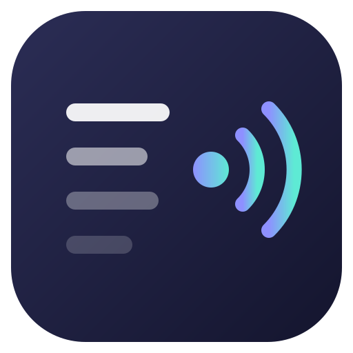
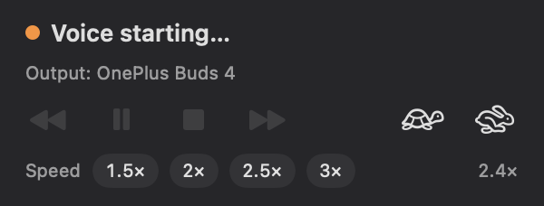

<div align="center">



# Earshot

**Listen instead of read.**<br>
A macOS menu bar app that reads anything on screen aloud in a natural local voice —<br>web pages, mail, docs, PDFs, notifications — at 2–3× speed, only into your headphones.

[](https://github.com/Naman503/earshot/actions/workflows/ci.yml)


[](LICENSE)

<br>



<sub>The menu bar popup while reading: live status, playback controls, slow/fast modes and one-click speeds.</sub>

</div>

---

## 📑 Contents

[Why](#-why) · [Highlights](#-highlights) · [Setup](#-setup) · [Permissions](#-permissions) · [Default controls](#-default-controls) · [Features in detail](#-features-in-detail) · [How it works](#-how-it-works) · [Privacy](#-privacy) · [Troubleshooting](#-troubleshooting) · [License](#-license)

## 💡 Why

Most of a day at a computer is reading — articles, replies, documentation, long chat answers. The Mac's built-in Spoken Content can read some of it, but:

- **It doesn't reach most apps.** Browser pages, Electron apps and PDFs need a selection first, if they work at all.
- **Robotic at speed.** System voices smear words together above ~1.5×; neural ones that sound good can't keep up.
- **No follow-along.** You can't glance back at the page and find the sentence being spoken.
- **It will happily blast your open-plan office.** There's no "headphones only".

Earshot is one app for all of it: point at any paragraph, tap the trackpad, and listen — with the spoken word highlighted on the page, the page scrolling itself like a teleprompter, and speech that stays clear at 2–3×. Everything runs on your Mac; no text or audio ever leaves it.

## ✨ Highlights

| | |
|---|---|
| **Point and tap** | A four-finger tap reads the paragraph under the pointer; double-tap reads from there to the end. Tap a selection to read just the selection. Works in every app — Safari, Chrome, Brave, Arc, Edge, Mail, PDFs, Electron apps — with OCR as the fallback for images. |
| **Natural and fast** | Kokoro-82M runs locally on Apple Silicon (~12× real time, first words in ~0.3 s). Speech is generated at its natural pace and time-stretched with WSOLA, so words stay crisp at 2–3×. 28 English voices plus Hindi voices for Devanagari text, chosen per paragraph automatically. |
| **Follow along** | The spoken word is highlighted on the page and the page auto-scrolls like a teleprompter — trigger line, glide distance and easing are all configurable. Click any word to jump the voice there. |
| **Headphones only** | Never speaks on the Mac speakers unless you allow it. Pauses when headphones disconnect, resumes when they're back. |
| **Notification announcer** | "WhatsApp. Rahul. Read it?" — answer yes/no by voice or a tap. Long messages are summarized on-device first. Playing media can duck or pause while a notification is read. |
| **Media aware** | Other audio (videos, Spotify, calls) ducks while Earshot speaks and fades back after — or pauses outright, your choice. |
| **Summaries** | A 3–5 sentence spoken gist of any page or selection from Apple's on-device model, then "Read the whole page?". |
| **Auto-read** | New text on chosen sites or apps — a chat reply, a search answer — is read once it stops changing. Your own typing is never read. |
| **Yours to tune** | Every shortcut and gesture is rebindable; voices, speeds, scrolling, highlight style, notification rules and text cleanup are all in Settings. |

## 🚀 Setup

Earshot is built from source (a notarized download may come later). You need:

- A Mac with **Apple Silicon** (M1 or newer — the voice model runs on [MLX](https://github.com/ml-explore/mlx))
- **macOS 15** or newer (macOS 26 for on-device summaries)
- **Xcode Command Line Tools** (`xcode-select --install`) and **[uv](https://docs.astral.sh/uv/)** (`brew install uv`)

**1. Clone and install the speech engine** (~1 GB download once — the Kokoro voice model and its Python packages; fully offline afterwards):

```bash
git clone https://github.com/Naman503/earshot.git
cd earshot
scripts/install-engine.sh
```

**2. Build and install the app:**

```bash
cd app
scripts/bundle.sh release
ditto build/Earshot.app /Applications/Earshot.app
open /Applications/Earshot.app
```

**3. Grant permissions** when Earshot asks (see below), plug in your headphones, put the pointer on any paragraph and **tap the trackpad with four fingers**.

> **Tip:** `scripts/bundle.sh` signs ad-hoc by default. If you have a development certificate, build with `SIGN_IDENTITY=<identity> scripts/bundle.sh release` so permission grants survive rebuilds.

## 🔐 Permissions

| Permission | Needed for | Required? |
|---|---|---|
| **Accessibility** | Reading text under the pointer, trackpad gestures, the follow-along highlight | Yes |
| **Screen Recording** | OCR fallback for images, PDFs and apps without accessible text | Optional |
| **Microphone** | Answering "Read it?" by voice (yes/no is recognized on-device) | Optional |
| **Audio capture** | Ducking other apps' audio while Earshot speaks | Optional |

Each one is explained and linked from **Earshot → Settings → General**; everything optional degrades gracefully when not granted.

## ⌨️ Default controls

Every shortcut and gesture below is rebindable in Settings.

| Action | Shortcut | Gesture |
|---|---|---|
| Read selection, or paragraph under pointer | ⌃⌥R | 4-finger tap |
| Read from pointer to the end | ⌃⌥A | 4-finger double-tap |
| Read the whole section (heading to heading) | ⌃⌥B | |
| Read everything visible on screen | ⌃⌥V | |
| Read the whole window | ⌃⌥W | |
| Pause / resume | ⌃⌥P | 3-finger double-tap |
| Stop | ⌃⌥S, or Esc while reading | 5-finger tap |
| Next / previous sentence | ⌃⌥→ / ⌃⌥← | |
| Next / previous paragraph | ⌃⌥⇧→ / ⌃⌥⇧← | |
| Faster / slower | ⌃⌥↑ / ⌃⌥↓ | |
| Slow / fast mode (hold, or toggle to stay) | configurable | |
| Read the clipboard | ⌃⌥C | |
| Read the last thing again | ⌃⌥Z | |
| Mac dictation (hold to talk, or tap to start/stop) | ⌃⌥D | |
| Auto-read new text on this page (on/off) | ⌃⌥L | |
| Summarize the page or selection, then offer to read it | ⌃⌥G | 4-finger triple-tap |
| Read latest notification / answer "yes" | ⌃⌥N | 4-finger tap while it asks |

## 🔎 Features in detail

**Reading anything.** Text comes from the Accessibility API — including web content in Chromium browsers and Electron apps via text markers, which most readers can't reach — with character-range precision in native text views, and Vision OCR as the fallback for images, PDFs and stubborn apps. Paragraph reach is configurable: just the paragraph, N paragraphs around it, or to the end.

**Speech that keeps up.** The Kokoro engine generates at the voice's natural pace and the app time-stretches it with WSOLA, which preserves consonants that pitch-correcting players smear. In a Whisper transcription test at 2×, mishearing dropped from 21% of words to 8% versus naive speed-up. Sentences are synthesized a few ahead at every speed mode you use, so speed switches are instant and seamless.

**Follow along.** Per-word timings from the engine drive a highlight drawn over the page. When the spoken line nears the bottom, the page glides up like a teleprompter — trigger line, glide distance, easing and behavior when you've scrolled away are all in Settings. The highlight rides your manual scrolling too, and clicking any word jumps the voice there. OCR readings get a highlight as well.

**Notifications.** Banners are announced by app and sender, with per-app rules and quiet hours: read in full, summarize first, announce only, or stay silent. Answer "Read it?" by voice — recognition is on-device. A playing video can keep playing, duck, or pause while the notification is read.

**Hindi.** Paragraphs that are mostly Devanagari switch to a Hindi voice automatically (choose which in Settings → Voice), so mixed Hindi/English pages read naturally end to end.

**Pronunciations.** Teach it names and jargon once in Settings; reading pauses while another app is on a call.

## ⚙️ How it works

```
┌──────────────┐  four-finger tap   ┌─────────────────┐  sentences   ┌──────────────────┐
│  Trackpad /  │ ─────────────────▶ │   Earshot.app    │ ───────────▶ │  Kokoro engine    │
│  shortcuts   │                    │  (Swift, AppKit) │ ◀─────────── │  (Python, MLX)    │
└──────────────┘                    └─────────────────┘  audio+words └──────────────────┘
                                     │          │
                        Accessibility│          │word timings
                        text markers ▼          ▼
                               the page    highlight + auto-scroll
```

- [`engine/server.py`](engine/server.py) — resident Kokoro-82M (MLX) process; the app drives it over stdio, one sentence per request, a few sentences ahead, every speed variant from one voice pass.
- [`app/Sources/Earshot/TextGrabber.swift`](app/Sources/Earshot/TextGrabber.swift) — Accessibility text markers for web content, character ranges for native text views, Vision OCR as fallback.
- [`app/Sources/Earshot/HUD.swift`](app/Sources/Earshot/HUD.swift) — the on-page word highlight and teleprompter auto-scroll.
- [`app/Sources/Earshot/Trackpad.swift`](app/Sources/Earshot/Trackpad.swift) — raw multitouch frames → tap recognizer.
- [`app/Sources/Earshot/NotificationWatcher.swift`](app/Sources/Earshot/NotificationWatcher.swift) — new Notification Center banners via Accessibility; `Announcer.swift` decides what to say; `VoiceReply.swift` hears yes/no on-device.
- [`app/Sources/Earshot/Ducker.swift`](app/Sources/Earshot/Ducker.swift) — a Core Audio process tap of everything except Earshot, replayed through a private aggregate device at a ramped gain.
- [`app/Sources/EarshotCore`](app/Sources/EarshotCore) — the testable core: text cleanup, tap recognition, OCR layout, auto-read diffing, preferences.

## 🔒 Privacy

Everything runs on your Mac. **No text, audio or telemetry leaves it** — the engine downloads its model once at install and runs offline from then on. Logs stay in `~/Library/Logs/Earshot/earshot.log`.

## 🩹 Troubleshooting

- **Nothing happens on a four-finger tap** — check Accessibility is granted (Settings → General), and that your trackpad gesture isn't taken by the system (System Settings → Trackpad).
- **"Couldn't find text under the pointer"** — some apps expose no accessible text; grant Screen Recording so OCR can take over.
- **No sound** — Earshot is headphones-only by default. Connect headphones, or allow the speakers in Settings → Media.
- **The voice is quiet next to your video** — turn on ducking (Settings → Media), or raise the volume boost.
- **A fresh build lost its permissions** — sign with a stable identity: `SIGN_IDENTITY=<cert> scripts/bundle.sh release`.

## 📄 License

[MIT](LICENSE) © 2026 Naman
